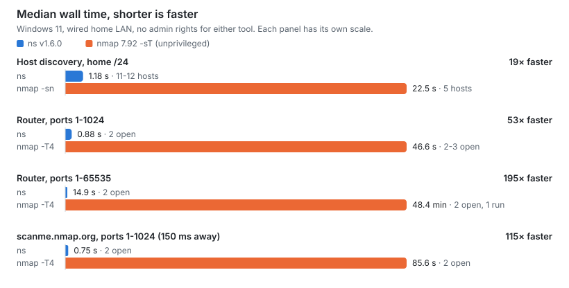

# NetScanner


NetScanner finds live hosts on your local network and scans their
ports. It needs no root privileges and no extra tools, and a full
`/24` sweep usually takes about 2 seconds.

By default, discovery combines fast TCP probes with mDNS and SSDP
service discovery and a pass over the local ARP table, so quiet
hosts (phones, printers, TVs) that drop TCP still show up. If that does not fit your network, `--ping` falls back to
one ICMP ping per host. In a terminal, a status line shows how far
the scan has got, and Ctrl+C stops it early with the hosts found so
far. Piped output streams each host as it is found instead. Either
way, a sorted recap with a host count and elapsed time closes the
scan.

## Speed

<picture>
  <source media="(prefers-color-scheme: dark)" srcset="docs/assets/ns-vs-nmap-dark.svg">
  
</picture>

Measured against nmap 7.92 on the same targets, with no admin rights
for either tool, so nmap scans with TCP `connect()` just as `ns` does.
Windows 11, wired to a home router that drops probes to closed ports.
Every case ran 10 times per tool in random order; nmap ran 3 times
against scanme.nmap.org and once on the full port range.

| Case | `ns` | nmap | Found |
|---|---|---|---|
| Host discovery, home /24 | 1.18 s | 22.5 s (`-sn`) | `ns` 11-12 hosts, nmap 5 |
| Router, ports 1-1024 | 0.88 s | 46.6 s (`-sT -T4`) | `ns` 2 open, nmap 2-3 |
| Router, ports 1-65535 | 14.9 s | 48.4 min (`-sT -T4`) | 2 open each |
| scanme.nmap.org, ports 1-1024 | 0.75 s | 85.6 s (`-sT -T4`) | 2 open each |

Unprivileged nmap discovers hosts only by trying TCP ports 80 and 443,
so it misses phones, TVs and smart-home devices that `ns` finds
through mDNS, SSDP and the ARP table. nmap did find one port `ns` did
not: the router's DNS port (TCP 53), in 17 of its 20 runs on ports
1-1024. The router drops some SYNs to that port, and `ns` gives up on
a silent port after two tries. nmap with admin rights (SYN scan, ARP
discovery) is faster than shown here and was not measured. Commands,
p90s and the rest of the method are in
[docs/benchmarks.md](docs/benchmarks.md).

## Install

Requires [Zig](https://ziglang.org/) 0.17.0 (see
`build.zig.zon`) when building from source.

Download a prebuilt binary from
[GitHub Releases](https://github.com/Criseda/NetScanner/releases)
(v1.0.0 and later, with builds for Windows, macOS x86_64/arm64 and
Linux x86_64/arm64), or build it yourself:

```sh
zig build
./zig-out/bin/ns --help
```

## Usage

```sh
ns -s <subnet> [options]       # Find live hosts (example: 192.168.0.0/24)
ns -p <ip> <port-range>        # Scan one host for open ports (example: 192.168.1.1 1-1024)
ns -s|-p ... --json            # One JSON object per line, for scripts and apps
ns --help                      # Display help message
ns --version                   # Display version
```

`ns -s` uses fast TCP, multicast (mDNS, SSDP) and ARP discovery by default (`--ping` uses ICMP).
Add `--resolve` (or `--hostname`, `--vendor`) to see device names and hardware manufacturers:

```sh
ns -s 192.168.0.0/24 --resolve
```

Output:
```text
IP               HOSTNAME                  MAC                MANUFACTURER
192.168.1.1      gateway                   00:50:56:a1:b2:c3  VMware, Inc.
192.168.1.10     nas-storage               00:11:32:11:22:33  Synology Incorporated
192.168.1.25     raspberrypi               2c:cf:67:aa:bb:cc  Raspberry Pi (Trading) Ltd
192.168.1.42     workstation               70:85:c2:44:55:66  ASRock Incorporation
192.168.1.105    smart-light               ec:b5:fa:01:02:03  Philips Lighting BV
192.168.1.140    game-console              fc:ca:40:77:88:99  Sony Interactive Entertainment Inc.
```

## Apps

Prefer a window to a terminal? Two apps wrap the same `ns` engine, with
no scanning logic of their own:

- [NetScannerDesktop](https://github.com/Criseda/NetScannerDesktop) for
  Windows (WinUI 3).
- [NetScanner for macOS](https://github.com/Criseda/NetScanner-MacOS)
  (SwiftUI, macOS 26 and later).

## Docs

- [docs/README.md](docs/README.md) has the full guide: install options, build and
  test commands, release builds and notes on each discovery mode.
- [docker/README.md](docker/README.md) describes the Linux test lab, a virtual LAN you
  can scan without owning a Linux box.
- [docs/benchmarks.md](docs/benchmarks.md) compares `ns` with nmap:
  commands, medians, p90s and what each tool found.

## License

GNU GPL-3.0, see [LICENSE](LICENSE).
